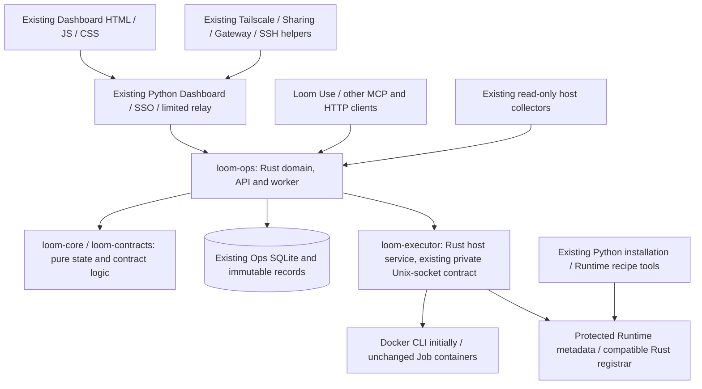

# Loom Rust variant — review and implementation proposal

Status: planning only. Branch: `codex/loom-rust`. Baseline:
`4d93ab9bdcb5750f3d0be161925e834984492f89` (alpha.60).
No Rust Loom service, schema migration, operational repair or deployment is
introduced by this branch. Pale's separate implementation does not authorize a
Loom cutover or make its Task semantics Loom Job semantics.

## Scope decision

Move the platform execution and Job domain toward Rust while retaining the web
application and expensive external integrations. Keep registered research
Components/Tools, Python/Isaac/ML dependencies and their Runtime images unchanged.
The language of a scheduler never dictates the language of a submitted Job.

The review covers all **297 baseline tracked files / 46,423 lines**, including
169 Python files, 65 Markdown documents, frontend/generated assets, JSON/schema,
Compose/systemd/build configuration and tests. The exact inventory and per-file
disposition are in [FILE-REVIEW.json](FILE-REVIEW.json). Review methods and concrete
findings are separated in [REVIEW.md](REVIEW.md); structural coverage is not a
claim that every external behavior has been live-tested.

## Proposed architecture

These crate names are proposed responsibilities, not implemented artifacts. Do
not merge all services into one privileged process: Ops keeps no Docker/GPU
socket, the host executor remains a separate authority, and the public Gateway
remains request-only. Async tasks do not change those trust/resource boundaries.

Retain initially:

- Dashboard, Gateway web assets, empty-data template/build pipeline and browser
  authentication/relay implementation.
- Tailscale/provider integration, session/crypto libraries, SSH account helpers
  and their least-privilege host contracts.
- Python JSON Schema validation until draft/format/error compatibility is proved;
  expose a narrow private bridge rather than silently changing accepted input.
- Python/shell installation, immutable release/kit/update/snapshot tooling,
  read-only hardware collectors and administrator dependency recipe builders.
- All user-owned research source/configuration, scientific validators and runtime
  dependencies. The port is not a research-code or data migration.

The retained installer may invoke a Rust Runtime registrar after its metadata
write authority is deliberately transferred. Until then, preserve the existing
administrator writer and let the Rust executor read/verify its compatible DB.
Never leave two independent implementations racing to own the same transition.

## Block plans

| Block | Detailed plan | Primary decision |
|---|---|---|
| Identity | [identity](blocks/identity.md) | Rust domain scopes; retain SSO/session integration |
| API | [api](blocks/api.md) | Preserve HTTP/MCP contracts; share one operation dispatcher |
| Queue | [queue](blocks/queue.md) | Rust ordering/eligibility with transactional claims |
| Execution | [execution](blocks/execution.md) | Executor first, then worker/stages/receipts |
| Recovery | [recovery](blocks/recovery.md) | Preserve incident/lease/round semantics |
| Results | [results](blocks/results.md) | Exact locators, provenance, indexing and lineage |
| Extensions | [extensions](blocks/extensions.md) | Immutable software/Profile/Runtime pins and derived Dependencies |
| Catalog | [catalog](blocks/catalog.md) | Read-only parity before overlays; preserve history |
| Observations | [observations](blocks/observations.md) | Retain collectors; port typed readers first |
| Dashboard | [dashboard](blocks/dashboard.md) | Retain implementation and verify unchanged consumers |
| Onboarding | [onboarding](blocks/onboarding.md) | Live guides, source identity and pinned client compatibility |
| Network | [network](blocks/network.md) | Retain provider/Gateway/Sharing integration |
| Portability | [portability](blocks/portability.md) | Existing identities, snapshots and fencing |
| Installation | [installation](blocks/installation.md) | Verified artifacts, cumulative update/rebuild and rollback |
| Testing | [testing](blocks/testing.md) | Independent parity/fault/browser/packaging evidence |
| SSH | [ssh](blocks/ssh.md) | Retain privilege helper; preserve read-only discovery |
| Diagnostics | [diagnostics](blocks/diagnostics.md) | Sanitized errors and private, non-blocking collection |

## Dependency-aware work sequence

| Phase | Work | Required exit evidence |
|---|---|---|
| 0 | Accept scope, close review findings and capture baseline fixtures | Complete file/contract ownership and retained-boundary decisions |
| 1 | Extract contracts, IDs, pure states, canonical hashes and compatibility harness | Cross-language request/hash/error fixtures and no mutation authority |
| 2 | Implement compatible Rust host Executor | CPU container launch/cancel/return, restart and lost-reply acceptance |
| 3 | Implement read-only catalog, software and observation projections | Differential responses plus unchanged browser acceptance |
| 4 | Switch queue, worker and recovery together | One Ops writer, durable claims, callbacks/finalizer and crash reconciliation |
| 5 | Move result/extension/curation writes and chosen Runtime registrar | Preserved sealed bytes, lineage, atomic publication and exact replay |
| 6 | Complete Rust Ops HTTP/MCP routing with retained trust/validation boundaries | Actual pinned client and browser contracts, including failures |
| 7 | Complete immutable packaging, fresh install, skipped-version update and rollback | Identity/DB/file/storage parity and explicit external-test limits |

Pure core work and read-only projection work can overlap conceptually, but this
plan does not authorize parallel mutation owners. Queue, worker, recovery and
outbox changes must be integrated as one coherent Ops authority. A service can be
implemented before its operational cutover phase; that is not readiness to deploy.

## Preservation and rollback rules

Follow [COMPATIBILITY.md](COMPATIBILITY.md). Reuse SQLite formats and existing IDs
initially. An additive schema still requires a migration/rollback design: older
workers must remain fenced if they cannot understand newly owned work. Never
clear an unknown ticket to make an update pass, remap an active store, recreate a
credential or rewrite an immutable Profile because its Rust representation differs.

Use isolated state/stores/projects for development. A comparison implementation
may read recorded observations but must not replay a real external action. Keep
source fixtures synthetic or explicitly sanitized; host settings, tokens, data
and private operational evidence stay outside this repository.

## Planning decisions before implementation

1. Accept the retained Python boundaries above and the Executor-first sequence.
2. Select supported build targets/libc and artifact delivery. Prefer prebuilt
   verified binaries for operators; do not require a compiler on production hosts.
3. Define which old client/schema versions the first Rust variant must support.
   The proposed minimum is the current alpha.60 behavior, plus retained historical
   state that alpha.60 itself accepts; skipped-version updates remain cumulative.
4. Approve any intentional behavior correction separately from mechanical parity,
   with its trigger, expected result, preservation impact and regression case.

An effort estimate follows the contract-capture spike; a line-count translation
estimate would omit the substantial integration and compatibility work. No
production deployment date or automatic activation is implied by this plan.
